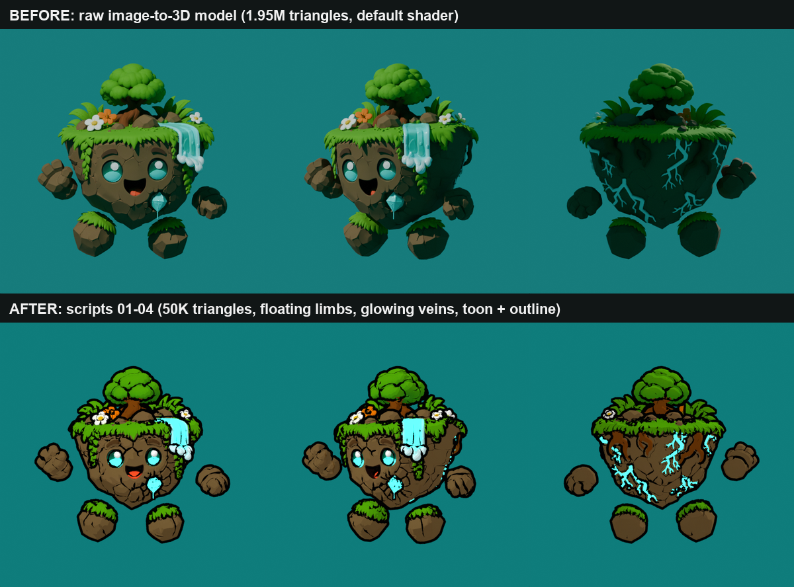
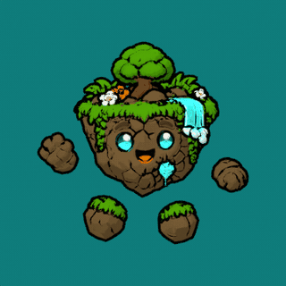
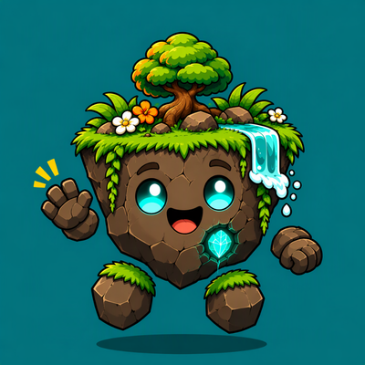
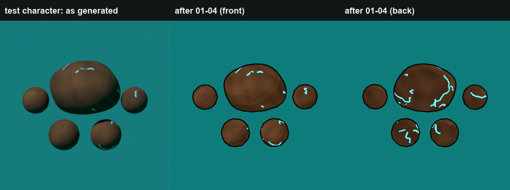

# 01 · Ilhinha: from an AI drawing to a 3D mascot, fixed with Blender Python

Video: https://youtu.be/dvrbTwH31JI

Ilhinha ("little island" in Portuguese) is the mascot of the channel. In the video we design her in 2D, turn the
drawing into a 3D model with an image-to-3D tool, and then fix what the tool got wrong with Python in Blender.
This folder has that Python part: one script per technique shown in the video, written so they run on **any** model,
not only on ours.



 

*Left: the result of scripts 01 to 04 (48-frame turntable, the veins pulse and the hands and feet float while it turns).
Right: the 2D design it has to look like.*

## The steps, as in the video

| Video | What goes wrong | Script | What it does |
|---|---|---|---|
| 2:31 | The generated model has almost 2 million triangles: too heavy to animate | [`01_decimate.py`](01_decimate.py) | Merges duplicate vertices, then a Decimate (Collapse) modifier down to `--target-tris` (50,000 for Ilhinha). Same silhouette. |
| 2:46 | The generator glued the hands and feet to the body | [`02_separate_limbs.py`](02_separate_limbs.py) | Splits the mesh into loose parts, finds the body (biggest part), the hands and the feet, moves them away so they float, fills the holes. `--float` adds a looping idle where hands and feet follow the body a few frames late. |
| 2:57 | The crystal veins are only painted on | [`03_crystal_veins.py`](03_crystal_veins.py) | Finds the vein colour in the texture (hue / saturation / brightness window) and plugs it into the emission, multiplied by a `VeinPulse` value that loops smoothly: they glow and pulse. |
| 3:09 | A 3D render does not look like the drawing | [`04_toon_outline.py`](04_toon_outline.py) | Toon shader (N·L into a CONSTANT colour ramp: hard light bands, emission kept) and a black outline (inverted hull: Solidify with flipped normals and a black material). |

Two helpers:

- [`render_preview.py`](render_preview.py): still views from any angle, or a turntable (PNG frames for a GIF). Camera frames the model by itself.
- [`make_test_character.py`](make_test_character.py): builds a small stand-in character (a rock body with four touching
  "limbs" and painted cyan veins, all in one mesh, like the generator output), so you can try everything without a model.

The 2D design (image generator) and the first 3D model (image-to-3D tool) are not code, so they are not here.
Ilhinha's 3D model is not included either.

## Requirements

- **Blender 4.4** (tested on 4.4.3). Any Blender 4.x should work; 3.x will not (socket names changed in 4.0).
- Nothing else: the scripts only use what ships with Blender (`bpy`, `bmesh`, `mathutils`, `numpy`).
- CPU is enough. Every command below uses Cycles on the CPU.

Below, `blender` means your Blender executable (on Windows, `blender.exe` in your Blender install folder).

## How to run

Each script reads a model (`--input`, or the `.blend` you open), does one step, and writes a new `.blend`
(`--save`). Your input file is never overwritten. Run `blender -b --python <script>.py -- --help` to see all options.

**On your own model** (a .glb/.gltf, .fbx, .obj or .blend with one character mesh and a textured Principled material):

```bash
blender -b --python 01_decimate.py        -- --input my_model.glb --target-tris 50000 --save step1.blend
blender -b step1.blend --python 02_separate_limbs.py -- --float --save step2.blend
blender -b step2.blend --python 03_crystal_veins.py  -- --hue 0.40 0.58 --color 3FF5E8 --save step3.blend
blender -b step3.blend --python 04_toon_outline.py   -- --outline 0.015 --save step4.blend
blender -b step4.blend --python render_preview.py    -- --views 0,35,180 --frame 25 --out renders/after.png
```

**With the test character** (no model needed):

```bash
blender -b --factory-startup --python make_test_character.py -- --save test.blend
blender -b test.blend  --python 01_decimate.py        -- --target-tris 1200 --save step1.blend
blender -b step1.blend --python 02_separate_limbs.py -- --objects Character --float --save step2.blend
blender -b step2.blend --python 03_crystal_veins.py  -- --save step3.blend
blender -b step3.blend --python 04_toon_outline.py   -- --save step4.blend
blender -b step4.blend --python render_preview.py    -- --views 0,180 --frame 25 --res 360 --out renders/test.png
```



**A GIF** like the one above (48 frames = one vein pulse and one float cycle, so it loops cleanly):

```bash
blender -b step4.blend --python render_preview.py -- --turntable 48 --res 360 --samples 8 --out frames/turn.png
ffmpeg -framerate 24 -i frames/turn_%04d.png -vf "scale=320:-1,split[a][b];[a]palettegen[p];[b][p]paletteuse" -loop 0 turntable.gif
```

### Options you will want to change

All sizes are a **fraction of the model height**, so the defaults work at any scale
(Ilhinha is about 1 m tall, so `0.015` is 1.5 cm on her).

| Script | Option | Default | Meaning |
|---|---|---|---|
| all | `--objects` | every mesh | comma-separated mesh names to work on |
| 01 | `--target-tris` | 50000 | triangles to keep |
| 02 | `--gap` / `--drop` / `--spread` | 0.10 / 0.085 / 0.02 | hands move out / feet move down / feet move out |
| 02 | `--min-share` | 0.01 | a loose part is a limb if it has at least 1% of the body's faces (smaller bits are joined back) |
| 02 | `--feet-zone` | 0.15 | limbs whose centre is in the bottom 15% of the body are feet, the others are hands |
| 03 | `--hue` | 0.40 0.58 | hue window of your veins (0 red · 0.17 yellow · 0.33 green · 0.5 cyan · 0.67 blue) |
| 03 | `--color` / `--strength` / `--period` | 3FF5E8 / 3.0 / 48 | glow colour, brightness, frames per pulse |
| 04 | `--light` | -0.45 -0.65 0.62 | direction to the toon light |
| 04 | `--outline` / `--outline-color` | 0.015 / 010101 | outline thickness and colour (0 = no outline) |

Names after step 2: `Body`, `Hand_L`, `Hand_R`, `Foot_L`, `Foot_R` (L = the viewer's left in Blender's front view).

## Things we learned (and you may hit too)

- **Everything cyan glows.** Step 3 picks the vein colour from the texture, so other cyan areas (Ilhinha's eyes and
  waterfall) glow too. Narrow `--hue`, raise `--min-sat`, or repaint those areas a little.
- **Even offset spikes.** On a decimated AI mesh, Solidify's *Even Thickness* and *High Quality Normals* made 1 m spikes
  in the outline. Step 4 keeps them off.
- **Thin stray geometry gets outlined.** The outline draws the edge of any thin tube or flap left by the generator.
  On Ilhinha, a 4 cm tube under the seed looked like drool; we collapsed its 4 vertices into one point (faces with
  zero area disappear from the render and from the outline). That fix was specific to our mesh, so there is no script for it.
- **Toon colours need the Standard view transform.** AgX/Filmic wash the flat bands out; step 4 switches to Standard.

## Tested

Blender 4.4.3, headless, CPU only (8 threads), Windows. Every script exited with code 0 (`--python-exit-code 1`).

| Model | 01 | 02 | 03 | 04 | renders |
|---|---|---|---|---|---|
| `make_test_character.py` (1,664 faces) | 2,048 → 1,200 triangles | 5 parts: body, 2 hands, 2 feet | veins from the painted texture | toon + outline on 5 objects | 3 stills |
| Ilhinha, raw image-to-3D model (.glb, not included) | 1,953,290 → 50,000 triangles in 18 s | 6 parts: body, 2 hands, 2 feet, 1 small bit joined back | veins from the base colour texture | toon + outline on 5 objects | 6 stills + 48-frame turntable (43 s) |

## Where this comes from

The video was made with one long script that did all of this in one go on our model (fixed file names and object
names, coordinates measured on Ilhinha). These files are that code split into one script per technique, with the
fixed names and paths turned into options. Our production version also baked a colour-corrected texture and used
masks drawn by hand around the eyes and the waterfall; those parts only make sense on our model, so they were left out.

The images in this folder and the Ilhinha character are not under the MIT license; see [LICENSE](../LICENSE).
