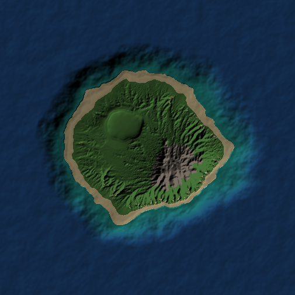

# 02 · I gave an AI agent Unreal Engine 5.8. Can it build a real world?

Video: https://youtu.be/6mfvdNNykww

An AI agent (Claude Code) got an empty Unreal Engine 5.8 project, a live MCP connection to the editor and one prompt:
build a small island world with terrain, a lake, a forest and golden-hour light, and check every step with a screenshot.
None of the 52 editor toolsets could create a landscape, so in round 2 the agent **wrote its own terrain generator in
plain Python** (no numpy) and imported the result into Unreal.

This folder has that generator: [`gen_island.py`](gen_island.py), exactly as the agent wrote it during the recorded
session, plus the one tuning pass it made to it a minute later (same session, before the import). Nothing was added
or cleaned up by hand.



*The preview the script wrote during the session (hillshade + colour by height).*

## What it does

| Block in `gen_island.py` | What it does |
|---|---|
| value noise, `fbm()`, `ridged()` | Noise from a shuffled table (seed 7): smooth hills (fBm) and sharp crests (ridged). |
| design | A domain-warped coastline, a beach, rolling hills and one mountain, on a 505 x 505 grid (1 m per pixel). |
| hydraulic erosion | 60,000 water droplets run downhill, pick up sediment on steep parts and drop it where they slow down. |
| thermal smoothing | Six passes that move material down any slope steeper than the talus limit. |
| lake | Picks the lake level from the terrain around it, raises a rim so it holds water and carves the basin. |
| output | A 16-bit `.r16` heightmap (32768 = sea level) and a `_preview.png`, written with `struct` + `zlib` only. |

## How to run

Python 3 only (standard library, no numpy, no Blender, no Unreal needed):

```bash
python gen_island.py 60000 island_505.r16
```

The first argument is the number of erosion droplets (default 60000), the second the output file. About 15 s on one
CPU core. It prints the lake level and the height range and writes `island_505.r16` and `island_505_preview.png`.

In Unreal the `.r16` is a 505 x 505 landscape heightmap. The script's docstring has the numbers the agent used
(landscape origin at -252 m, -252 m; Z scale 100, so 1 unit = 0.78125 cm; 32768 = z 0).

## The bug from the video: the island 256 m below sea level

The agent's first import, through its own helper script, made the whole landscape sit **256 m below sea level**. The
helper read the heights as raw 16-bit values, so 0.54 became 0, and 0 on Unreal's 16-bit scale is -256 m (with Z scale
100). The fix it made in the session (19:30:41) was one line:

```diff
- SCALE = float(globals().get("HEIGHT_SCALE", 1.0))
+ SCALE = 65535.0
```

That helper (`import_height.py`) drives the Unreal editor through its Python console and has paths from the recording
machine, so it is not published here; the generator above is the part you can reuse anywhere.

## Tested

Python 3.12, Windows, CPU: `python gen_island.py 60000 island_505.r16` printed `height range m -28.04 47.44` (the same
range as in the session log) and `lake level m 10.42` (the session log says 10.35), in about 15 s. The preview here is
the one from the session; a run on your machine can differ by a few pixels around the lake.
