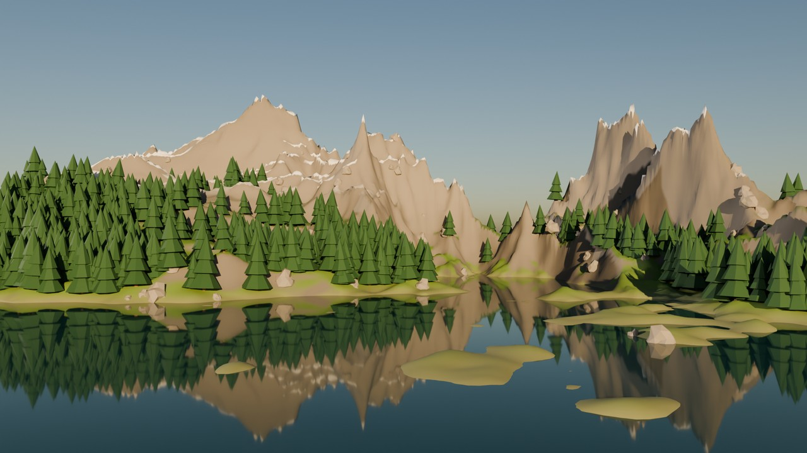
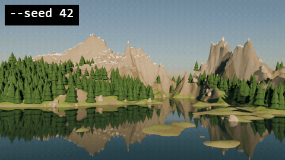

# 03 · 200 lines of Python made this landscape

Video: coming soon

One Blender Python file builds a whole valley: ridged-noise mountains, a lake, slope-aware materials, a physical sky,
1,500 trees and 250 rocks. No sculpting, no geometry nodes, no downloaded assets. **One number (the seed) = one world.**





*The same script, unchanged, with nine seeds (640x360 previews).*

The file is [`landscape.py`](landscape.py), exactly the one shown in the video: 271 lines, 217 without blank lines
and comments.

## The steps, as in the video

| Video | Block in `landscape.py` | What it does |
|---|---|---|
| 0:23 One number | 1. settings · 2. an empty scene | Reads `--seed`, `--out`, `--res`, `--samples`. The seed picks an `OFFSET`: where in the infinite noise field this world is cut from. |
| 0:53 The height function | 3. `ridged()`, `height()`, `terrain()` | Ridged multifractal noise (sharp crests), domain warp, keep only the crests, low in front and high at the back, a basin for the lake, soft borders. A 300x300 grid gets its Z from `height()`. |
| 1:51 A beige wall | `height()`, `camera()`, `sky()` | The first render was a beige wall. The bug: raw ridged noise goes from about 0.5 to 1.9, not 0 to 1, so more than half of the map was mountain. Subtracting 0.9 keeps only the crests and `** 1.6` keeps the valleys flat. The camera (moved inside the map, 7 m above the ground) and the sky (strength 0.08) were adjustments, not the cause. |
| 3:31 Painting with height and slope | 4. `terrain_material()` | Colour by height (sand, meadow, forest floor, rock, snow) and rock wherever the surface is steep, with noise for grain and bump. All in shader nodes built from Python. |
| 4:20 Water and sky | 5. `water()`, `sky()` | A plane at the lake level with a water material; a physical (Nishita) sky with a golden-hour sun that changes with the seed. |
| 4:51 One tree, fifteen hundred times | 6. `tree_mesh()`, `rock_mesh()`, `scatter()` | One tree mesh (a trunk and three cones, 62 triangles) and one rock, copied as linked duplicates. Trees only on gentle slopes in forest patches; rocks only where it is steep. |
| 5:44 One number, new world | 7. `camera()`, `main()` | Camera, render, done. Change `--seed` and you get a different valley. |

## Requirements

- **Blender 4.4** (tested on 4.4.3). Uses only what ships with Blender.
- CPU is enough: the script sets Cycles to the CPU itself.

## How to run

```bash
# quick preview, about 7 s on 2 CPU threads
blender -b --factory-startup -t 2 --python landscape.py -- --seed 42 --out preview.png --res 640 360 --samples 16

# full image (defaults: 1920x1080, 64 samples)
blender -b --factory-startup --python landscape.py -- --seed 7 --out seed7.png
```

`blender` is your Blender executable (on Windows, `blender.exe` in your Blender install folder). Without `--out` the image is written as
`landscape.png` next to the (unsaved) blend file, so pass `--out` with a path you know.

### Numbers to play with (top of the file)

| Name | Value | Meaning |
|---|---|---|
| `SIZE`, `DIV` | 120.0, 300 | terrain width in metres and grid resolution |
| `PEAK` | 28.0 | height of the tallest mountains in metres |
| `WATER` | 2.2 | lake level |
| `scatter(..., 1500, ...)` | 1500 / 250 | number of trees / rocks (in `main()`) |

## Tested

Blender 4.4.3, headless, CPU only (2 threads), Windows:
`--seed 42 --res 640 360 --samples 16` printed `seed=42 trees=1500 rocks=250`, rendered in 6.0 s, exit code 0.
The image is identical, pixel for pixel, to the one rendered for the video (0 of 230,400 pixels differ).

## Notes

- The script was written and run by an AI coding assistant, bugs included (the video shows the beige-wall bug and its fix).
- Renders in the video that use a flight camera, a study light or top-down maps were made for the video; they are
  not part of this script. The images in this folder come from the script as it is.

The images in this folder are not under the MIT license; see [LICENSE](../LICENSE).
