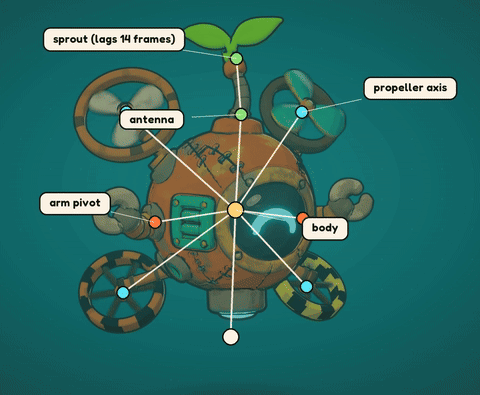
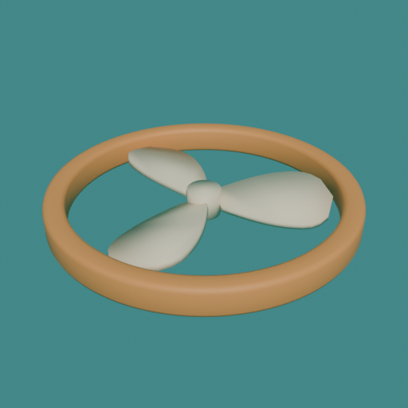

# 05 · AI made my drone in 3D. It couldn't fly.

Video: https://youtu.be/WJsC8znyZXU (Procedural Arthur, episode on Seed the scrap drone)



Seed, the channel's scrap drone, started as an AI drawing; an image-to-3D tool turned it into a model that looked great
from the front. But it was a statue: 1,902,608 triangles in one single mesh, and every propeller was one fused lump
(ring, blades and hub in one surface, the ring tilted up to 16 degrees away from the blades). Spin that, and everything
wobbles. We tried four ways to cut the blades out with code; all four failed. So we deleted the four propellers and
**modelled new ones in Python**, each built around its own exact axis, so it spins true by construction. Then, before
rendering anything, we checked **every frame of every clip** for any part entering the space the propellers sweep.

This folder has those two techniques, rewritten so they run on their own (no Seed model needed):



*`propeller.py` output, frame 1 of the spin loop (Cycles, CPU, 32 samples).*

| Video | Script | What it does |
|---|---|---|
| 4:06 "Simple parts, in the same style" | [`propeller.py`](propeller.py) | Builds a fixed **Ring** (rounded profile swept around Z) and a **Rotor** (hub + N paddle blades with pitch and round tips) as one object whose origin is on the spin axis, merges duplicate vertices and recalculates normals (the "bug of the day": blades with inward faces lost their outline), animates a seamless spin loop and prints a **spin check**: rotor centre of mass distance from the axis and tilt of its symmetry axis (0 mm, 0°), next to a copy tilted like the AI model's ring (4 mm, 11.2°). |
| 5:58 "Does any part enter the space the propellers sweep?" | [`swept_volume_check.py`](swept_volume_check.py) | For every rotor, the swept cylinder in its local space; then, frame by frame, counts the vertices of every other mesh inside it. Seed's 6 clips: 0 hits. `--demo` adds an arm that swings into the disc, to see a hit. |

What is not here: the AI drawings and the image-to-3D model (not code), and Seed's own model and build script (it reads
the measured centre, axis and radius of each propeller from our project files). The propellers in the video use the
same builders as `propeller.py`, plus painted rust, stripes and a segmented arm.

## Requirements

- **Blender 4.4** (tested on 4.4.3). Any Blender 4.x should work.
- Nothing else: only what ships with Blender (`bpy`, `bmesh`, `mathutils`, `numpy`). CPU is enough.

## How to run

```
blender -b --python propeller.py -- --blades 3 --out propeller.blend --preview images/propeller.png
blender -b propeller.blend --python swept_volume_check.py
blender -b propeller.blend --python swept_volume_check.py -- --demo
```

Expected output (tested on 22 Nov 2026):

```
SPIN CHECK rotor: {'off_axis_mm': 0.0, 'tilt_deg': 0.0}  (built around Z: spins true)
SPIN CHECK tilted copy (11.2 deg, 4 mm off): {'off_axis_mm': 4.0, 'tilt_deg': 11.2}  (this one would wobble)
SWEPT VOLUME CHECK: 1 rotor(s), 1 other mesh(es), frames 1-120 step 1: NO HITS
SWEPT VOLUME CHECK: 1 rotor(s), 2 other mesh(es), frames 1-120 step 1: 9 frame hits
  Rotor <- DemoArm: frames 56-64 (9 checked frames, up to 144 vertices)
```

Options of `propeller.py`: `--radius 0.20` (outer ring radius, metres), `--pitch 12` (blade pitch, degrees),
`--frames 120 --turns 3` (the loop: 3 turns in 4 s at 30 fps), `--tilt-demo 11.2`, `--gif-frames DIR` (renders the loop).
On your own file, name the spinning parts with a common prefix and run
`swept_volume_check.py -- --rotor-prefix YourPrefix --step 2`.

## Made with AI

The scripts in the video were written and run by an AI coding assistant (Claude Code), from the command line; these
two were adapted from them for this repository by the same assistant and tested as above.
