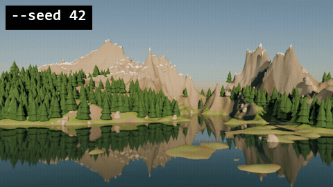

# Worlds built with code

**Worlds built with code: Blender, Python, Unreal Engine 5 & AI.**
The scripts behind the videos of the [Procedural Arthur](https://www.youtube.com/@ProceduralArthur) YouTube channel, one folder per episode.

| # | Episode | Preview | Video | Code |
|---|---|---|---|---|
| 01 | Ilhinha, the channel mascot: from an AI drawing to a 3D character, fixed with Blender Python |  | https://youtu.be/dvrbTwH31JI | [01-ilhinha-mascot](01-ilhinha-mascot/) |
| 02 | I gave an AI agent Unreal Engine 5.8: the terrain generator it wrote in plain Python |  | https://youtu.be/6mfvdNNykww | [02-ai-agent-unreal](02-ai-agent-unreal/) |
| 03 | 200 lines of Python made this landscape |  | https://youtu.be/-TVunsf7klQ | [03-python-landscape](03-python-landscape/) |
| 04 | I gave my AI agent real assets: it planted 124,966 plants in Unreal 5.8, then crashed the editor | | https://youtu.be/lZH6nyIS61g | no code folder: the agent wrote it inside the Unreal project during the session |

More episodes will be added as they come out.

## How to use

Every folder has its own README with the steps from the video, the Blender version it was tested on and the exact
command line. The scripts run headless (`blender -b ... --python ...`) on the CPU, so you do not need a GPU.

## License

Code: [MIT](LICENSE). Images, renders and the Ilhinha character are **not** under the MIT license
(all rights reserved); see [NOTICE.md](NOTICE.md).
